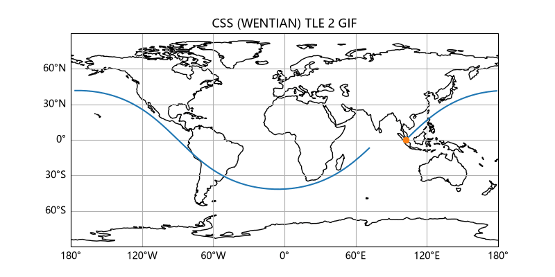

# 项目02 TLE to GIF
- 输入含规范TLE信息的网址 
- 输出所给卫星星下点的GIF动画
> 效果展示
 - 信息来源[celestrak(wentian)](https://celestrak.org/NORAD/elements/gp.php?CATNR=53239&FORMAT=TLE)
 - 

## 环境要求
 1. python 3.12+
 2. 第三方包
  -  Pillow
  -  matplotlib
  -  cartopy
  -  skyfield
  -  numpy
  下载方式
> pip install <模块>
## 使用方法
1. 直接生成 GIF 图像 
 ```powershell
    python main.py draw <网址> 
```
     
    
2.  生成图像并显示参数
```powershell
python main.py --debug draw <网址>
```
3. 如果要改变时间跨度，修改main.py（146）的count
   >count/10即为gif时间（seconds）
### 轨道参数
> name 
> epoch
> inclination
> raan
> eccentricity
> arg_perigee
> mean_anomaly
> mean_motion

### 退出码
- 指令行输入有误：2
- 网络异常，无法获取TLE数据：3
- TLE信息格式有误： 3
- 程序顺利完成： 0  
  
## GIF 说明
步长：30s
帧数： 180
画面： （800，400）

## 工作原理
网址——下载文件——解析TLE——算星下点轨迹——画图——GIF

## 项目结构
1. 主体代码在 main.py 中
2. 测试代码在 tests
    `python -m pytest -v `以调用
3. DESIGN.md 设计大纲

## 注意事项
 1. 图像起始时间为 epoch 所示，图像随时间推移误差增大
 2. 星下点纬度为大地纬度
 3. cartopy 在绘制含 NaN（用于断线）的轨迹时，
会报RuntimeWarning: invalid value encountered in linestrings。
已知无害（图形正常、退出码 0），不处理。
   
## 数据来源
CelesTrak，Skyfield,cartopy
&&THX for DSH&&

